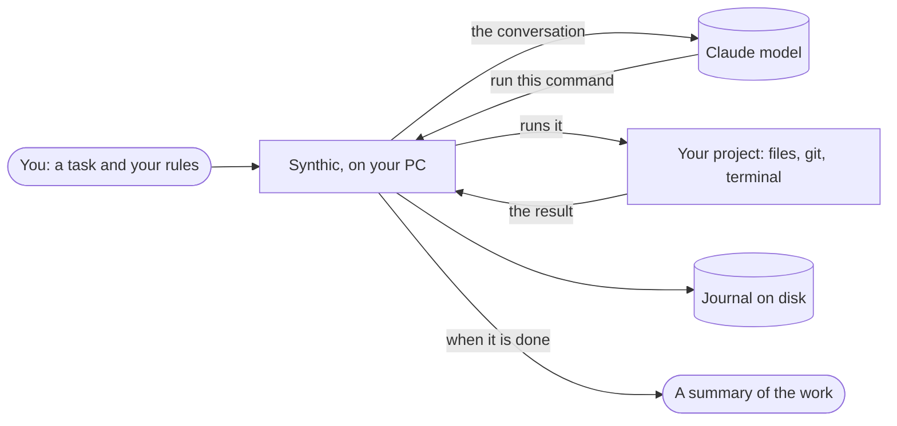

# Synthic

An agent harness: the program that lets a Claude model work on your project by itself. You give it a
task and your rules (model, budget, what it may touch). It runs the commands the model asks for, writes
everything down, and stops when the work is delivered.



## Install on Windows

No Python needed.

1. Open PowerShell and paste this line:

    ```powershell
    irm https://raw.githubusercontent.com/Dyarchia/dyarchia-synthic/main/install.ps1 | iex
    ```

2. Save your Anthropic API key (get one at console.anthropic.com):

    ```powershell
    setx ANTHROPIC_API_KEY "paste-your-key-here"
    ```

    Synthic reads `ANTHROPIC_API_KEY` from the environment of the terminal and, on Windows, from your user
    environment in the registry, so a terminal opened by an app that started before this step still finds it.
    The agent's own commands never see it.

3. Close the terminal, open a new one, and check:

    ```powershell
    synthic --version
    ```

To update, paste the line of step 1 again. To uninstall, delete `%LOCALAPPDATA%\Programs\synthic`.

## Use it

Go to the folder of your project and give it a task:

```powershell
cd C:\Users\you\my-project
synthic run "Add a --verbose flag to cli.py and a test for it"
```

To work on one screen instead, as in other coding agents, type it alone:

```powershell
synthic
```

Write a task and press Enter. `/` lists the commands (`/model`, `/effort`, `/resume`, `/clear`, `/view`,
`/context`, `/export`, `/help`), Esc interrupts the agent, Ctrl+C twice leaves, and so does typing `exit` or
`quit` while nothing is working. Ctrl+C first clears the message box, then stops a working run, and only
then, pressed twice, leaves.

The screen needs a real terminal: PowerShell, cmd, Windows Terminal, or Git Bash through `winpty synthic`.
Where standard input or output is a pipe it stops with a message instead of starting.

Here a person is at the terminal (`human.present`): the agent answers a greeting or a question in prose and
waits for your next message, and when it asks you something it waits, and what you type is the answer.

The tabs at the top draw the same run in four ways, and Ctrl+T moves through them: `Column` (one
conversation), `Panes` (agents, conversation, and the full text of a step), `Fleet` (the agents side by
side) and `Ledger` (one row per step, with time and cost). Shift+Up and Shift+Down change the agent you
talk to; Ctrl+Up and Ctrl+Down move the selected step.

```text
Command                          What it does
-------------------------------  ---------------------------------------------------
synthic                          Open the screen: start, follow and steer runs
synthic "task"                   Open the screen on that task
synthic run "task"               Do a task from start to finish
synthic resume RUN "next task"   Go on in the same conversation
synthic runs                     List your runs
synthic show RUN                 Read what a run did, step by step (--md for Markdown)
synthic stop RUN                 Stop a run from another terminal (or press Ctrl+C)
synthic policy                   Show the rules in force and where each one comes from
```

## Your rules

Synthic decides nothing for you. Model, effort, budget and permissions come from a policy file, for
example `%USERPROFILE%\.synthic\policy.toml`:

```toml
[role.build]
model = "sonnet"
effort = "medium"

[budget]
dollars = 5

[permissions]
"sh: git push*" = "deny"
```

Every key, and everything else the engine does, is in the [reference](docs/REFERENCE.md).

## From source

Python 3.12 or newer. `py -m pip install -e .` and `py -m pytest -q`. Only Windows is tested so far.

## License

Apache-2.0. See [LICENSE](LICENSE) and [NOTICE](NOTICE).
